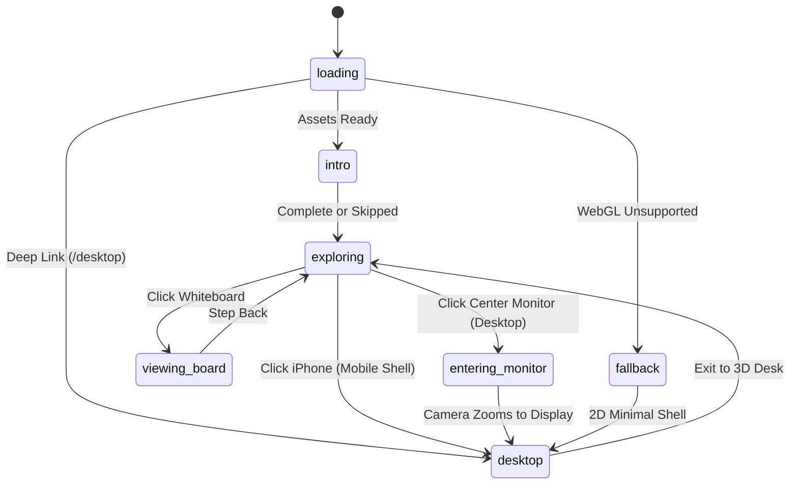

# Jordan Vorster — 3D Interactive Portfolio

[](https://jordanvorsterwebsite.online)
[](https://react.dev/)
[](https://www.typescriptlang.org/)
[](https://threejs.org/)
[](https://vite.dev/)
[](https://github.com/golba98/3D_Portfolio_Website)

An interactive, 3D developer portfolio and digital workstation. Visitors explore a realistic digital twin of my physical desk, sketch on an interactive whiteboard, and transition directly into a simulated **Fedora GNOME desktop** (or an **iOS shell** on mobile) to inspect projects, run terminal commands, and browse my work.

🌐 **Live Website:** [jordanvorsterwebsite.online](https://jordanvorsterwebsite.online)

---

## 🌟 Highlights

- **3D Interactive Scene (Blender & Three.js / R3F)**: A high-fidelity 3D model of my real-life desk setup with dynamic lighting, smooth camera rigs, touch/pointer parallax, and raycasted element interactions.
- **Interactive Whiteboard**: Walk up to the desk whiteboard and sketch with marker pens and erasers. Includes full keyboard accessibility and automatic local persistence via `localStorage`.
- **Dual Operating System Experience**:
  - **Desktop (Fedora / GNOME Shell)**: Custom Libadwaita-themed window manager with draggable/resizable windows, activities overview, application dock, places menu, and system tray.
  - **Mobile (Simulated iPhone / iOS)**: Responsive mobile shell featuring a SpringBoard home screen, gesture-based app switcher, search sheet, and control centre.
- **In-Environment Applications**:
  - **Terminal (`kitty`)**: Simulated Unix shell supporting custom commands, file navigation, and `neofetch`.
  - **Projects (`GNOME Builder`)**: Interactive showcase of real-world projects with technical deep dives, architectural diagrams, and repository links.
  - **Files (`Nautilus`)**: Hierarchical file system browser to explore resume assets, source code, and project docs.
  - **System Info (`Settings`)**: Hardware specifications, host Fedora setup, and real-time site engine stats.
  - **About & Contact (`Contacts` & `Geary`)**: Bio, BSc Computer Science background (University of London), vector province map, and resume download.
- **Performance-First Architecture**:
  - Zero-cost direct routing: Navigating to `#/desktop` completely bypasses Three.js, downloading 0 kB of 3D assets.
  - Custom glTF optimization pipeline (Meshopt + WebP) compressing source assets for rapid load times.
  - Graceful fallback for non-WebGL environments and accessible `<noscript>` SEO markup.

---

## 🏗️ Architecture & State Machine

The entire user journey transitions through a deterministic Zustand state machine (`src/store/experience.ts`):



### Bundle Splitting & Lazy Loading

1. **3D Scene Deferred**: The Three.js canvas, `@react-three/fiber` runtime, and glTF models are lazy-loaded. Deep-links directly to `#apps` or `#/desktop` render the 2D desktop immediately without touching WebGL.
2. **Desktop Apps On Demand**: All desktop window applications (`About`, `Projects`, `Terminal`, `Files`, `SystemInfo`, `Contact`) are code-split via `React.lazy`. The initial dock renders lightweight metadata; application code only fetches when first opened.

---

## 🛠️ Tech Stack

| Domain | Technologies |
|---|---|
| **Core Framework** | React 19, TypeScript, Vite |
| **3D & Graphics** | Three.js, React Three Fiber (R3F), Drei, Maath |
| **State & Animation** | Zustand, Framer Motion |
| **Asset Pipeline** | `@gltf-transform/core`, `meshoptimizer`, `sharp` (WebP), Blender |
| **Design & UI** | GNOME Adwaita design system, CSS Modules, Inter Variable, JetBrains Mono |
| **Hosting & Security** | Cloudflare Workers / Pages, Strict Content Security Policy (CSP), HSTS |

---

## 📂 Project Structure

```
├── assets-src/            # Uncompressed source assets (raw glTF exports)
├── public/
│   ├── icons/             # Desktop & app icons (GNOME Adwaita & Kitty)
│   ├── models/            # Meshopt-compressed WebP-packed glTF 3D scene
│   ├── shots/             # Project screenshots & previews
│   └── _headers           # Cloudflare security headers (CSP, HSTS, Permissions)
├── scripts/
│   ├── optimize-model.mjs # glTF optimization pipeline (meshopt, deduplication, WebP)
│   └── check-model.mjs    # Scene validation (ensures required node names & bounds)
└── src/
    ├── app/               # Main application entry, root layout & router
    ├── apps/              # Desktop applications (Terminal, Projects, Files, etc.)
    │   └── registry.ts    # Central registry for app metadata & lazy components
    ├── components/
    │   ├── adw/           # Libadwaita UI components (HeaderBar, ViewSwitcher, Preferences)
    │   ├── desktop/       # GNOME desktop shell, WindowManager, Dock, TopBar, Overview
    │   ├── phone/         # iOS shell, SpringBoard, AppSwitcher, ControlCentre
    │   ├── scene/         # 3D canvas, camera rigs, lighting, surface placement
    │   └── ui/            # Shared UI primitives, canvas drawing overlay
    ├── config/            # Tunable camera poses, timings, lighting, and theme constants
    ├── data/              # Typed portfolio content (projects, profile, hardware, skills)
    ├── hooks/             # Custom React hooks (keyboard navigation, media queries, touch)
    └── store/             # Zustand stores (experience state, windows, whiteboard)
```

---

## 🚀 Getting Started

### Prerequisites

- **Node.js**: `v20.x` or higher
- **npm**: `v10.x` or higher

### Installation

1. Clone the repository:
   ```bash
   git clone https://github.com/golba98/3D_Portfolio_Website.git
   cd 3D_Portfolio_Website
   ```

2. Install dependencies:
   ```bash
   npm install
   ```

3. Start the local development server:
   ```bash
   npm run dev
   ```
   Open [http://127.0.0.1:5173](http://127.0.0.1:5173) in your browser.

---

## 🔧 Development & Build Scripts

| Command | Description |
|---|---|
| `npm run dev` | Starts Vite dev server on `127.0.0.1:5173` |
| `npm run build` | Runs TypeScript compilation (`tsc -b`) followed by Vite production build |
| `npm run preview` | Locally previews the production build in `dist` |
| `npm run typecheck` | Validates TypeScript types across the codebase |
| `npm run lint` | Runs ESLint checks |
| `npm run model:optimize` | Optimizes `assets-src/pc-setup-source.glb` into `public/models/pc-setup.glb` |
| `npm run model:check` | Verifies required glTF nodes (`Chair`, `Whiteboard_Surface`, etc.) and prints bounds |

### Debug & Testing Flags

In local development, the app supports URL query parameters for fast inspection:

- `?pose=introSide` — Locks the camera to the intro perspective.
- `?pose=presentation` — Locks the camera to the wide workstation presentation angle.
- `?pose=monitorFocus` — Zooms and locks camera directly on the center display.
- `?fallback` — Forces the 2D non-WebGL fallback mode for accessibility testing.

*(Note: Debug parameters are automatically ignored in production builds).*

---

## 🎨 3D Asset & Model Optimization Pipeline

The workstation scene is modeled in Blender (`PC_Setup_Hero`) and exported to glTF. To deliver fast load times over consumer networks, the asset undergoes an automated optimization pipeline via `scripts/optimize-model.mjs`:

```
Blender Export (.glb) ──▶ assets-src/pc-setup-source.glb
                                │
                                ▼
                       [ gltf-transform ]
                       ├── Node deduplication & welding
                       ├── Merging draw calls for static meshes
                       ├── WebP texture recompression (via sharp)
                       │   ├── 2048x2048 for high-detail keyboard legends
                       │   └── 1024x1024 for desk and hardware textures
                       └── Meshoptimizer encoding (medium level)
                                │
                                ▼
                       public/models/pc-setup.glb
```

Run the pipeline at any time with:
```bash
npm run model:optimize
npm run model:check
```

---

## 🔒 Security & Deployment

The production site is deployed as static assets through **Cloudflare Workers / Pages**.

- **Security Headers**: `public/_headers` injects strict security rules into production:
  - **Content Security Policy (CSP)**: Locks down origins; prevents unauthorized scripts; GitHub public API is the sole permitted external connection.
  - **X-Frame-Options & Framing**: Strict `DENY` framing protections.
  - **HSTS**: `max-age=31536000; includeSubDomains; preload`.
  - **Permissions Policy**: Camera, microphone, and geolocation are disabled.
- **Privacy First**: Zero third-party trackers, analytics, or external ad scripts.

---

## 📄 Attribution & Credits

- **App Icons**: Standard full-colour GNOME icons ([GNOME Design Team](https://gitlab.gnome.org/GNOME)) and kitty terminal icon by Kovid Goyal. See [public/icons/apps/README.md](public/icons/apps/README.md).
- **Desktop Wallpaper**: Abstract black Fedora wallpaper (`public/wallpaper.webp`).
- **Mobile Wallpapers**: iPhone 15 Pro Titanium wallpapers via iClarified (`public/wallpaper-iphone.webp`).
- **Geography Data**: Province vector outlines courtesy of Natural Earth (Public Domain).

---

## 👤 Author

**Jordan Vorster**  
BSc Computer Science student, University of London

- **Website:** [jordanvorsterwebsite.online](https://jordanvorsterwebsite.online)
- **GitHub:** [@golba98](https://github.com/golba98)
- **Email:** [jordanvorster404@gmail.com](mailto:jordanvorster404@gmail.com)
